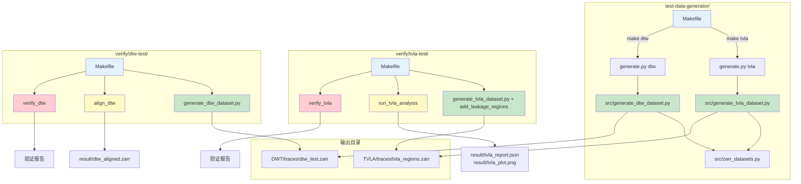

# Squirrel Test Framework Flowchart



---

## 使用流程

### 数据生成
```bash
cd test-data-generator
make tvla   # → TVLA/traces/tvla_regions.zarr
make dtw    # → DWT/traces/dtw_test.zarr
```

### TVLA 测试
```bash
cd verify/tvla-test
make verify  # generate → analyze → verify
```

### DTW 测试
```bash
cd verify/dtw-test
make verify  # generate → align → verify
```